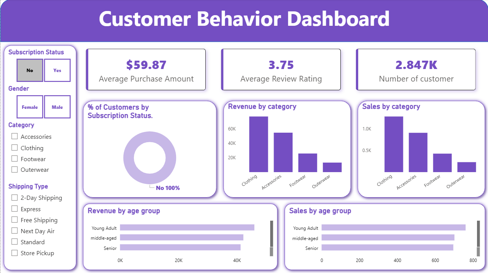

<div align="center">

# Customer Behavior Analysis Dashboard

An end-to-end customer shopping analysis using Python, PostgreSQL, SQL, and Power BI.


**Muhammad Ali Nawaz**  
Power BI Developer / Data Analyst

</div>

---

## 📌 Project Overview

This project analyzes customer shopping records to explore purchase behavior, product categories, discount use, customer ratings, shipping, and subscription status. A Python notebook prepares the supplied dataset, a SQL script contains business-analysis queries, and a Power BI report presents a filtered customer overview.

## 🎯 Business Questions

- How does purchase revenue differ by gender and product category?
- Which products have the highest average review ratings?
- How do discounts and shipping types relate to purchase amounts?
- How do purchase amounts differ by subscription status?
- Which products are most frequently purchased within each category?
- How can customers be grouped using their previous-purchase counts?

## 📊 Dataset Scope

| Dataset detail | Supplied data |
| --- | ---: |
| Customer records | 3,900 |
| Source columns | 18 |
| Unique customer IDs | 3,900 |
| Missing review ratings in source | 37 |

The source is a customer-level shopping dataset. It contains demographic, product, purchase, discount, shipping, rating, subscription, and purchase-frequency fields. The notebook fills missing review ratings using the median for each product category.

## 🧰 Technology Stack

| Technology | Use in this project |
| --- | --- |
| Python and pandas | Cleaning, feature engineering, and data loading |
| PostgreSQL | Local analytical table storage |
| SQL | Business-question queries and customer segmentation |
| Power BI Desktop | Filterable dashboard and KPI presentation |
| Jupyter Notebook | Analysis and preparation workflow |

## 🔄 Analysis Workflow

1. Load `customer_shopping_behavior.csv` in the notebook.
2. Fill missing review ratings by product-category median.
3. Standardize column names and derive age-group and purchase-frequency fields.
4. Check the discount and promo-code fields, then remove the redundant field.
5. Load the prepared DataFrame to the PostgreSQL `customer` table.
6. Run the queries in `customer_behavior_basic business questions.sql`.
7. Open `Customer_behavior_dashboard.pbix` to explore the report.

## 📊 SQL Analysis

The supplied SQL script includes grouped revenue and rating queries, a scalar average-purchase comparison, conditional discount analysis, customer segmentation with a CTE, and a `ROW_NUMBER()` ranking of products within each category.

The SQL script expects a PostgreSQL table named `customer`. The archive does not include a separate database DDL or schema migration file; the notebook creates/replaces the table with `DataFrame.to_sql`.

## 🖼️ Dashboard

The report includes KPI cards for average purchase amount, average review rating, and customer count, with filters for subscription status, gender, category, and shipping type.



## 📁 Project Structure

```text
customer_behavior_analysis_dashboard/
├── .ipynb_checkpoints/
│   ├── Customer analytics-checkpoint.ipynb
│   └── customer_shopping_behavior-checkpoint.csv
├── Customer analytics.ipynb
├── Customer_behavior_dashboard.pbix
├── customer_behavior_basic business questions.sql
├── customer_shopping_behavior.csv
├── dashboard_snapshot.png
├── LICENSE
├── README.md
└── .gitignore
```

## ✅ Reproducibility Notes

- Configure the notebook’s PostgreSQL connection for your own local environment before loading data. Do not commit credentials.
- Normalize `Frequency of Purchases` values before applying the notebook’s case-sensitive mapping; the supplied data uses `Weekly` while the mapping contains `weekly`.
- Cast discount counts to a numeric type before division in the discount-rate query to avoid integer truncation.
- Review the customer-segmentation and repeat-buyer query definitions before using their results for decisions.
- The Power BI report is included as a PBIX. The archive does not expose its complete DAX formulas or model relationships as separate source files.

## 👤 Author

**Muhammad Ali Nawaz**  
Power BI Developer / Data Analyst

## 📄 License

This project is released under the [MIT License](LICENSE). The license applies to original project materials; any third-party data or assets remain subject to their applicable terms.
